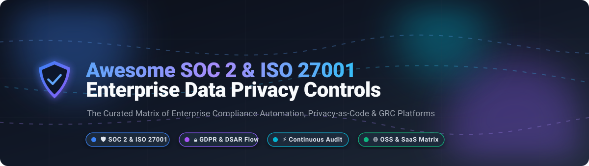

# 🛡️ Awesome SOC 2 / ISO Enterprise Data Privacy Controls 🔒

  <strong>A production-ready curated index of leading SOC 2 Type II, ISO/IEC 27001:2022, and enterprise data privacy platforms — spanning enterprise SaaS automation and cutting-edge open-source software for automated compliance evidence collection, DSAR fulfillment, continuous monitoring, and GRC engineering.</strong>

<!-- Badges Header -->

  
  
  
  
  
  

---

## 📑 Table of Contents
- [📈 Sector Overview & Market Dynamics](#-sector-overview--market-dynamics)
- [🏢 SaaS / Hosted Commercial Platforms](#-saas--hosted-commercial-platforms)
- [💻 Open-Source Software](#-open-source-software)
  - [🛡️ Compliance Automation & Cloud Security Scanning](#️-compliance-automation--cloud-security-scanning)
  - [🔐 Privacy Engineering, DSAR & Consent Management](#-privacy-engineering-dsar--consent-management)
- [⚖️ Feature Comparison Matrix](#️-feature-comparison-matrix)
- [🤝 Contributing](#-contributing)
- [📈 Star History](#star-history)
- [📄 License](#-license)

---

## 📈 Sector Overview & Market Dynamics

The global **Governance, Risk, and Compliance (GRC) and Compliance Automation** market is estimated at **$40B to $65B**, with the cloud-native compliance automation segment alone surpassing **$2.8B** and expanding at a rapid **CAGR exceeding 25%**. The market remains **moderately to highly fragmented** rather than winner-take-all: while enterprise buyers rely on established consolidated GRC suites (like ServiceNow and OneTrust) for multi-jurisdiction risk management, the hyper-growth mid-market and startup segments are vigorously contested by specialized automation platforms (such as Vanta, Drata, and Secureframe) and emerging open-source Privacy-as-Code engines solving continuous audit evidence collection and regional DSAR workflows.

---

## 🏢 SaaS / Hosted Commercial Platforms

Below is the comparative breakdown of leading commercial compliance and data privacy platforms, sorted in descending order of company size (valuation / enterprise scale).

| 🏢 Platform | 💰 Company Size (Valuation / Revenue) | 🏷️ Pricing (Starting Tier) | 🎁 Free Tier / Trial Limits | 🎯 Primary Focus & Strengths |
|---|---|---|---|---|
| **OneTrust** | **$4.5B - $5.0B Valuation** (~$500M+ ARR) | Starting ~$10,000/yr (single modules like web consent scale ~$800–$1,100/mo) | **No free tier or public self-serve trial** (Limited standalone free toolkits like CCPA opt-out builders; trial sandboxes require sales vetting) | Enterprise privacy management, consent management, DSAR fulfillment, vendor risk & AI governance |
| **Vanta** | **$2.45B Valuation** (~$140M+ ARR) | Starting ~$10,000 - $14,000/yr (Core Essentials for early startups 1–20 seats) | **No free tier or public self-serve trial** (Interactive guided demo required; sales-negotiated POC sandbox periods granted case-by-case) | Automated evidence collection for SOC 2, ISO 27001, HIPAA, GDPR & continuous cloud monitoring |
| **Drata** | **$2.0B Valuation** (~$100M+ ARR) | Starting ~$7,000 - $7,500/yr (Foundation plan for early startups under 50 seats) | **No free tier or public self-serve trial** (Demo call required; sales-approved proof-of-concept trial evaluation available upon qualification) | Continuous automated compliance monitoring, SOC 2/ISO 27001 readiness & risk management |
| **Securiti.ai** | **$1.725B Valuation** (Acquired by Veeam, ~$75M+ ARR) | Starting ~$50,000/yr median custom contract tier (AWS Marketplace enterprise baseline) | **No free tier or public trial for enterprise Data Command Center** (Developer/AI firewall tools have free limited query rate tiers; enterprise requires demo) | Unified Data Command Center, Data Security Posture Management (DSPM), PrivacyOps & AI security |
| **BigID** | **$1.0B - $1.25B Valuation** (~$100M+ ARR) | Starting ~$25,000 - $75,000+/yr (Base packages scale with data volume/petabytes scanned) | **No free tier or self-serve trial** (Offers a scoped complimentary risk assessment & targeted data-source POC scan post-demo) | Deep data discovery, PII classification, machine-learning data governance & privacy intelligence |
| **TrustArc** | **~$300M Valuation** (~$50M+ ARR) | Starting ~$10,000/yr (Modular pricing scaling by domains and data subjects) | **No free tier for core compliance platform** (Provides limited 14-day evaluation trial for *Nymity Research* database; platform demo required) | Comprehensive privacy certifications, GDPR/CCPA risk assessments & consent governance |
| **Secureframe** | **~$200M - $500M Valuation** ($79M total funding) | Starting ~$7,500/yr (Fundamentals entry-level tier for small teams) | **No free tier or public self-serve trial** (Requires personalized interactive demo session with compliance architects) | End-to-end audit readiness, automated evidence gathering, vendor management & employee security training |
| **DataGrail** | **~$200M - $250M Valuation** (~$15M - $20M ARR) | Starting ~$36,000/yr (Essentials tier baseline on marketplace listings) | **No free tier or self-serve trial** (Interactive guided platform tours and sales-tailored product demonstrations only) | Live Data Map discovery, automated Data Subject Access Requests (DSARs) & consent tracking |

---

## 💻 Open-Source Software

The open-source landscape provides transparent, self-hosted, and inspectable alternatives to commercial compliance tools. Below are the top open-source projects, **ranked by GitHub Stars (descending)**.

### 🛡️ Compliance Automation & Cloud Security Scanning

#### 1. Prowler 
- **Repository:** [prowler-cloud/prowler](https://github.com/prowler-cloud/prowler)
- **Tech Stack:** Python / AWS SDK / Azure SDK / GCP SDK | **License:** Apache-2.0
- **Overview:** Industry-standard multi-cloud security assessment and compliance tool. Performs automated security posture scanning, continuous monitoring, and compliance readiness against **SOC 2, ISO 27001, CIS Benchmarks, NIST 800-53, HIPAA, PCI-DSS**, and AWS/Azure/GCP Well-Architected Frameworks.
- **Best For:** DevOps and security engineers seeking automated, scriptable cloud compliance audits and tamper-proof reporting.

#### 2. ScoutSuite 
- **Repository:** [nccgroup/ScoutSuite](https://github.com/nccgroup/ScoutSuite)
- **Tech Stack:** Python / Multi-Cloud APIs | **License:** GPL-2.0
- **Overview:** Open-source multi-cloud security auditing tool by NCC Group. Gathers configuration data via cloud provider APIs to highlight risk areas and posture vulnerabilities across AWS, Microsoft Azure, Google Cloud Platform, Alibaba Cloud, and Oracle Cloud Infrastructure.
- **Best For:** Security teams conducting point-in-time compliance assessments and architectural reviews across heterogeneous multi-cloud estates.

#### 3. CISO Assistant 
- **Repository:** [intuitem/ciso-assistant-community](https://github.com/intuitem/ciso-assistant-community)
- **Tech Stack:** Python / Django / PostgreSQL / S3 | **License:** AGPL-3.0
- **Overview:** A modern, one-stop-shop Governance, Risk, and Compliance (GRC) platform. Automates risk management, audits, third-party risk (TPRM), privacy assessments, and reporting across **200+ global frameworks** including SOC 2, ISO 27001:2022, NIST CSF 2.0, CIS Controls, GDPR, HIPAA, NIS2, and DORA.
- **Best For:** Organizations and CISOs wanting an open-source, full-lifecycle GRC platform with pre-mapped control crosswalks.

#### 4. ComplianceAsCode 
- **Repository:** [ComplianceAsCode/content](https://github.com/ComplianceAsCode/content)
- **Tech Stack:** Python / SCAP / Ansible / Bash | **License:** BSD-3-Clause
- **Overview:** The primary declarative framework for automated compliance and security hardening. Provides SCAP content, automated remediation scripts, and Ansible playbooks to enforce baseline controls for ISO 27001, PCI-DSS, HIPAA, and NIST across Linux distributions and containers.
- **Best For:** Infrastructure engineers automating OS-level compliance enforcement and continuous configuration auditing.

#### 5. Openlane 
- **Repository:** [theopenlane/core](https://github.com/theopenlane/core)
- **Tech Stack:** Go / PostgreSQL / Redis / OpenFGA | **License:** Apache-2.0
- **Overview:** The most direct, modern open-source alternative to Vanta, Drata, and Secureframe. Purpose-built for SOC 2, GDPR, ISO 27001, and NIST 800-53 compliance workflows without proprietary paywalls. Features native RBAC/FGAC (OpenFGA), SSO/MFA out-of-the-box, task queues, and automated evidence management.
- **Best For:** Tech-forward engineering teams requiring a cloud-native, self-hosted compliance platform on a clean Go stack.

#### 6. GovReady-Q 
- **Repository:** [GovReady/govready-q](https://github.com/GovReady/govready-q)
- **Tech Stack:** Python / Django / PostgreSQL | **License:** GPL-3.0
- **Overview:** Automated compliance assessment engine that guides agile development teams through security documentation, System Security Plans (SSP), and control assessments via interactive question-and-answer interview workflows.
- **Best For:** Small organizations and public-sector vendors needing guided System Security Plans (SSPs) and structured compliance questionnaires.

#### 7. Blackfyre 
- **Repository:** [jonescyber-ai/Blackfyre](https://github.com/jonescyber-ai/Blackfyre)
- **Tech Stack:** Multi-Cloud / Python / AI Heuristics | **License:** MIT
- **Overview:** Multi-cloud compliance engine scanning AWS, Azure, and GCP against **678 controls across 9 frameworks** (SOC 2, ISO 27001, GDPR, HIPAA, NIST 800-53). Features AI-assisted gap analysis, MITRE ATT&CK mapping, and an evidence vault with SHA-256 tamper-evident verification.
- **Best For:** Cloud teams seeking deep infrastructure audit scanning combined with AI-assisted control remediation.

---

### 🔐 Privacy Engineering, DSAR & Consent Management

#### 8. c15t 
- **Repository:** [c15t/c15t](https://github.com/c15t/c15t)
- **Tech Stack:** TypeScript / Next.js / Tailwind CSS | **License:** Apache-2.0
- **Overview:** An observable, developer-first consent management platform (CMP). Offers TypeScript SDKs, auto-blocking of unauthorized scripts, geolocation-based consent jurisdiction routing (GDPR vs. CCPA), and turnkey wrappers for PostHog, Google Tag Manager, and Meta Pixel.
- **Best For:** Modern web applications and frontend teams needing an embedded, customizable privacy consent SDK.

#### 9. Klaro 
- **Repository:** [kiprotect/klaro](https://github.com/kiprotect/klaro)
- **Tech Stack:** JavaScript / TypeScript | **License:** BSD-3-Clause
- **Overview:** A clean, privacy-by-design consent manager and cookie banner. Compliant with GDPR, ePrivacy, and CCPA, it enforces strict opt-in logic, intercepts third-party trackers dynamically, and provides an accessible, responsive UI without tracking cookies itself.
- **Best For:** Privacy-conscious organizations needing a lightweight, zero-dependency consent banner compliant with strict EU regulations.

#### 10. tarteaucitron.js 
- **Repository:** [AmauriC/tarteaucitron.js](https://github.com/AmauriC/tarteaucitron.js)
- **Tech Stack:** Vanilla JavaScript | **License:** MIT
- **Overview:** A veteran script and cookie consent manager designed for European GDPR/CNIL compliance. Supports Google Consent Mode v2, Bing Consent Mode, and manual or automated blocking for hundreds of external third-party services.
- **Best For:** Content websites, media properties, and web developers wanting direct JavaScript control over third-party scripts.

#### 11. Fides (Ethyca) 
- **Repository:** [ethyca/fides](https://github.com/ethyca/fides)
- **Tech Stack:** Python / FastAPI / SQLAlchemy / React | **License:** Apache-2.0
- **Overview:** The benchmark open-source **Privacy-as-Code** platform. Automates end-to-end Data Subject Access Requests (DSARs), runtime PII discovery, privacy taxonomy tagging in code, and database-level erasure/retrieval execution for GDPR, CCPA, and LGPD.
- **Best For:** Backend software engineers wanting programmatic privacy governance integrated into Git workflows and CI/CD pipelines.

#### 12. ConsentOS 
- **Repository:** [ConsentOS/consentos](https://github.com/ConsentOS/consentos)
- **Tech Stack:** Python / FastAPI / Playwright / Docker | **License:** Elastic-2.0
- **Overview:** Enterprise-grade self-hosted CMP alternative to OneTrust and Cookiebot. Features automated Playwright cookie scanners, IAB TCF v2.3 and GPP compliance, dark-pattern detection (reject button asymmetry), and automated script blocking.
- **Best For:** Self-hosted enterprise deployments requiring IAB TCF compliance and deep cookie crawling capabilities.

#### 13. DSAR Engine (inthhq) 
- **Repository:** [inthhq/dsar](https://github.com/inthhq/dsar)
- **Tech Stack:** TypeScript / Bun / Turborepo | **License:** Apache-2.0
- **Overview:** A developer-focused Data Subject Access Request backend engine. Provides clean separation between machine API credentials and tenant identity projection (`resolveTrustedRequestIdentity`), supporting modular auth providers like Unkey.
- **Best For:** SaaS product builders wanting to plug an embeddable DSAR fulfillment engine into their multi-tenant SaaS backend.

#### 14. privacy-dsar-mcp-server 
- **Repository:** [AiAgentKarl/privacy-dsar-mcp-server](https://github.com/AiAgentKarl/privacy-dsar-mcp-server)
- **Tech Stack:** Python / Model Context Protocol (MCP) | **License:** MIT
- **Overview:** An MCP server for GDPR privacy compliance and DSAR deadline tracking. Enables AI assistants (like Claude Desktop) to log privacy requests, calculate 30-day Article 12 statutory deadlines, generate GDPR compliance scores, and maintain Article 30 Records of Processing Activities (RoPA).
- **Best For:** DPOs and privacy officers looking to manage privacy workflows and DSAR records through AI desktop assistants.

---

## ⚖️ Feature Comparison Matrix

| Project / Software | Category | Primary Focus | SOC 2 / ISO 27001 | DSAR Automation | Cookie / CMP | Self-Hosted / Deployment | License |
|---|---|---|:---:|:---:|:---:|:---:|---|
| **OneTrust** | Commercial SaaS | Complete Enterprise Trust Suite | 🔶 (Vendor) | ✅ | ✅ | ☁️ Managed SaaS | Proprietary |
| **Vanta** | Commercial SaaS | Automated Continuous Auditing | ✅ | 🔶 (Vendor) | ❌ | ☁️ Managed SaaS | Proprietary |
| **Drata** | Commercial SaaS | Continuous Compliance Monitoring | ✅ | 🔶 (Vendor) | ❌ | ☁️ Managed SaaS | Proprietary |
| **Securiti.ai** | Commercial SaaS | Data Command Center & DSPM | 🔶 | ✅ | ✅ | ☁️ Managed SaaS | Proprietary |
| **BigID** | Commercial SaaS | Data Intelligence & Discovery | 🔶 | ✅ | ❌ | ☁️ SaaS / Hybrid | Proprietary |
| **TrustArc** | Commercial SaaS | Privacy Assessments & Certifications | 🔶 | ✅ | ✅ | ☁️ Managed SaaS | Proprietary |
| **Secureframe** | Commercial SaaS | Audit Automation & Vendor Risk | ✅ | ❌ | ❌ | ☁️ Managed SaaS | Proprietary |
| **DataGrail** | Commercial SaaS | Live Data Mapping & Privacy Requests | ❌ | ✅ | ✅ | ☁️ Managed SaaS | Proprietary |
| **Prowler** | Open Source | Multi-Cloud Compliance & CIS Scanner | ✅ | ❌ | ❌ | 🐳 Docker / CLI | Apache-2.0 |
| **ScoutSuite** | Open Source | Multi-Cloud Security Auditing | ✅ | ❌ | ❌ | 🐍 Python / CLI | GPL-2.0 |
| **CISO Assistant** | Open Source | Comprehensive GRC & Risk Management | ✅ | 🔶 (GDPR) | ❌ | 🐳 Docker / Django | AGPL-3.0 |
| **ComplianceAsCode** | Open Source | Automated OS Hardening & SCAP | ✅ | ❌ | ❌ | 💻 Ansible / Bash | BSD-3-Clause |
| **Openlane** | Open Source | Open-Source Vanta Alternative | ✅ | 🔶 (Vendor) | ❌ | 🐳 Go / Postgres | Apache-2.0 |
| **GovReady-Q** | Open Source | Guided System Security Plans (SSP) | ✅ | ❌ | ❌ | 🐳 Docker / Django | GPL-3.0 |
| **Blackfyre** | Open Source | AI-Assisted Cloud Infrastructure Scan | ✅ | 🔶 (Controls) | ❌ | 🐳 Docker / Localstack | MIT |
| **c15t** | Open Source | Observable TypeScript Consent SDK | ❌ | ❌ | ✅ | 📦 NPM / Next.js | Apache-2.0 |
| **Klaro** | Open Source | Zero-Dependency Privacy Consent Banner | ❌ | ❌ | ✅ | 📦 Vanilla JS / NPM | BSD-3-Clause |
| **tarteaucitron.js** | Open Source | Lightweight Client-Side Script Manager | ❌ | ❌ | ✅ | 🌐 Vanilla JS Library | MIT |
| **Fides** | Open Source | Privacy-as-Code & DSAR Fulfillment | ❌ | ✅ | 🔶 (Banner) | 🐳 Docker / Python | Apache-2.0 |
| **ConsentOS** | Source Available | Self-Hosted Enterprise CMP & Crawler | ❌ | 🔶 (Rules) | ✅ | 🐳 Docker / FastAPI | Elastic-2.0 |
| **DSAR (inthhq)** | Open Source | Embeddable Multi-Tenant DSAR Engine | ❌ | ✅ | ❌ | ⚡ Bun / Turborepo | Apache-2.0 |
| **privacy-dsar-mcp** | Open Source | MCP Server for AI-Driven DSAR Tracking | ❌ | ✅ | ❌ | 🤖 Local Python / MCP | MIT |

---

## 🤝 Contributing

Contributions are warmly encouraged! If you know of an enterprise-grade compliance automation or data privacy tool that should be included:

1. **Fork the repository** 🍴
2. **Create a feature branch** (`git checkout -b feature/new-compliance-tool`) 🌿
3. **Add the project details** with verifiable citations, GitHub repo link, stack, license, and primary strengths 📝
4. **Ensure active maintenance** (releases or commits within the last 12 months) ⏱️
5. **Open a Pull Request** with a clear explanation of why the tool adds value 🚀

---

##  Star History

---

## 📄 License

This repository and curated index are distributed under the [CC0 1.0 Universal (Public Domain)](https://creativecommons.org/publicdomain/zero/1.0/) license. Individual software platforms, open-source repositories, and third-party trademarks referenced remain the property of their respective owners.

  Built with ❤️ for privacy engineers, compliance officers, and security teams worldwide.

